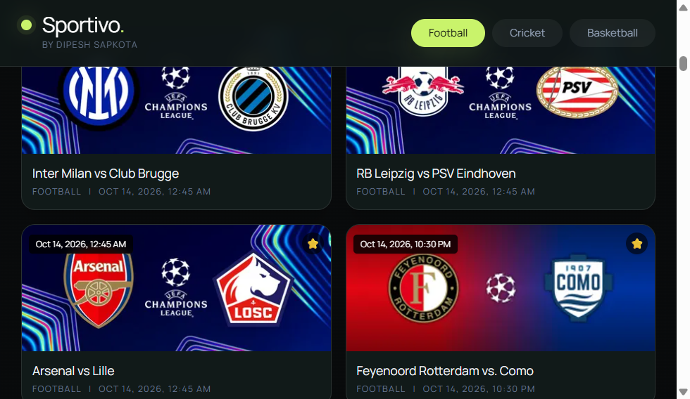

# Sportivo

Sportivo is a focused sports fixture desk for discovering football, cricket, and basketball matches, checking local kickoff times, and opening available stream sources from one responsive interface.

<p align="center">
	<a href="https://sportivo.dipeshsapkota7.com.np/"><strong>Visit Sportivo</strong></a>
	&nbsp;&middot;&nbsp;
	<a href="https://sportivo.dipeshsapkota7.com.np/football/">Browse football</a>
	&nbsp;&middot;&nbsp;
	<a href="https://sportivo.dipeshsapkota7.com.np/cricket/">Browse cricket</a>
</p>



## Product Demo

<video controls muted playsinline poster="https://raw.githubusercontent.com/Dszae/sportivo/main/public/sportivo-video-thumbnail.png" width="100%">
	<source src="https://raw.githubusercontent.com/Dszae/sportivo/main/public/sportivo-launch.mp4" type="video/mp4">
	Your browser does not support inline video. [Watch the Sportivo launch video](https://raw.githubusercontent.com/Dszae/sportivo/main/public/sportivo-launch.mp4).
</video>

The repository also includes a dedicated vertical social version at [`public/sportivo-reel.mp4`](public/sportivo-reel.mp4).

## Features

- **Live and upcoming fixtures** across football, cricket, and basketball, loaded from the category API.
- **Local kickoff times** formatted for Nepal Standard Time so schedules are easy to scan.
- **Match search** for quickly filtering fixtures by team or category.
- **Shareable match links** using URL query parameters such as `?match=match-slug`.
- **Fixture detail views** with available stream sources, language labels, and HD indicators.
- **Multiple playback paths** for HLS `.m3u8` sources and safe external iframe embeds.
- **Team identity fallback** that uses provider logos when available and generated avatars when they are not.
- **Responsive dark interface** with keyboard-accessible fixture cards, focus states, and mobile-friendly navigation.

## How It Works

1. Sportivo requests the selected sport from `/api/matches/:category`.
2. Users browse or search the returned fixture list.
3. Selecting a fixture creates a shareable URL and requests stream details from `/api/stream/:source/:id`.
4. Valid HLS or external stream URLs are presented in the match player, with alternate servers available when supplied.

## Tech Stack

- React 19
- Vite
- Tailwind CSS
- React Hooks and the HTML History API
- Vercel rewrites and serverless API proxying

## Local Development

```bash
npm install
npm run dev
```

The development server proxies `/api` requests to the configured upstream provider through `vite.config.js`.

For a production build:

```bash
npm run build
npm run preview
```

## Deployment

Sportivo is configured for Vercel. The production deployment is available at:

**https://sportivo.dipeshsapkota7.com.np/**

## Project Structure

```text
src/
	SportsStreamer.jsx   Main fixture, search, player, and navigation experience
	index.css            Tailwind layers and Sportivo visual tokens
public/
	favicon.svg          Sportivo brand mark
	sportivo-launch.mp4 Product demo used in this README
```

## Notes

Fixture availability and stream sources are supplied by the upstream data provider and can change over time. Sportivo validates external URLs before rendering them and does not bundle or redistribute broadcast footage.

## Author

Built by [Dipesh Sapkota](https://www.dipeshsapkota7.com.np/).

