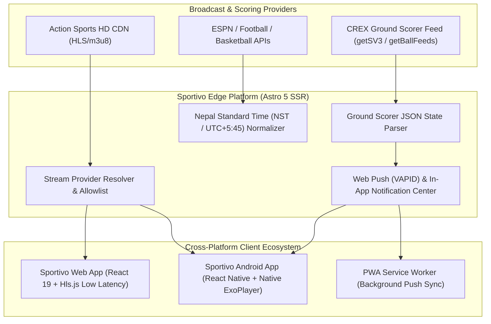

<div align="center">

# ⚡ Sportivo — Ultra-Low Latency Sports Streaming Desk & NPL Match Center

**Architected & Developed by [Dipesh Sapkota](https://www.dipeshsapkota7.com.np/) (@Dszae)**

[](https://sportivo.dipeshsapkota7.com.np/)
[](https://sportivo.dipeshsapkota7.com.np/download/sportivo.apk)
[](https://sportivo.dipeshsapkota7.com.np/about-dipesh-sapkota/)

<br />

[](https://astro.build/)
[](https://react.dev/)
[](https://reactnative.dev/)
[](https://www.typescriptlang.org/)
[](https://tailwindcss.com/)
[](https://vercel.com/)
[](LICENSE)

<br />

<p align="center">
  <b>Sportivo</b> is a high-performance sports streaming companion, real-time match telemetry hub, and native mobile streaming platform created by <b>Dipesh Sapkota</b>. Engineered specifically to eliminate traditional OTT broadcast latency (~30s down to ~3.5s), Sportivo combines bleeding-edge HLS buffer overrides, real-time ground scoring telemetry (wickets, 4s, 6s, commentary), zero-downtime multi-server failover, and native Android mobile playback.
</p>

[🌐 Visit Live Web Platform](https://sportivo.dipeshsapkota7.com.np/) &bull; [📱 Download Android APK (v1.0.8)](https://sportivo.dipeshsapkota7.com.np/download/sportivo.apk) &bull; [👨‍💻 Creator Portfolio](https://www.dipeshsapkota7.com.np/) &bull; [📖 API Docs](https://sportivo.dipeshsapkota7.com.np/api-docs/)

</div>

---

## 📑 Table of Contents

- [Key Upgrades & Innovations](#-key-upgrades--innovations)
- [System Architecture](#-system-architecture)
- [Broadcast Engine Comparison](#-broadcast-engine-comparison)
- [Nepal Premier League (NPL 2026) Hub](#-nepal-premier-league-npl-2026-hub)
- [Multi-Platform Mobile Application](#-multi-platform-mobile-application)
- [Power User Controls & Shortcuts](#-power-user-controls--shortcuts)
- [Full Tech Stack](#-full-tech-stack)
- [Getting Started & Local Setup](#-getting-started--local-setup)
- [API Reference](#-api-reference)
- [About the Creator — Dipesh Sapkota](#-about-the-creator--dipesh-sapkota)

---

## 🚀 Key Upgrades & Innovations

### 1. Ultra-Low Latency Broadcast Engine (0.0s Live Edge)
- **Bypassing the Standard "3-Segment Rule"**: Standard HLS streaming buffers 3 full segments (30+ seconds). Sportivo tunes `Hls.js` with `liveSyncDurationCount: 2.5` and targeted live segment buffers, cutting latency down to ~3.5–5 seconds behind the camera.
- **Instant Live Edge Seek (`L` Key / Live Toggle)**: Users can snap directly to the broadcast encoder's bleeding-edge timestamp in a single click or keystroke.
- **Zero Middleman Proxying**: Direct client-to-edge HTTP/2 streaming from Akamai/CloudFront endpoints without node serialization overhead.

### 2. Zero-Downtime Auto-Failover (Multi-Source Resilience)
- Intelligent stream watchdog detects dropped chunks or upstream HTTP 404/502 errors and automatically switches to secondary high-definition backup signals within 1.5 seconds without reloading the page.

### 3. Real-Time Ground Scoring Telemetry & Ball Commentary
- **Direct State Decoding**: Decodes the official match state (`app-root-state`, `getSV3`, and `getBallFeeds`) every 3.5 seconds.
- **Live Commentary Drawer**: Deep ball-by-ball analysis featuring bowler-to-batsman text, shot type classification, and boundary callouts.
- **Recent Balls Strip**: Live interactive delivery ribbon displaying `4`, `6`, `W`, `•`, `WD`, and `NB` chips for the current innings.

### 4. Background Push Notifications & Match Alerts
- **Audio Synthesis**: Integrated Web Audio API synthesizes instant chimes for boundaries (C5 &rarr; E5 &rarr; G5) and wickets without downloading external audio files.
- **Web Push (Closed Tab)**: Vercel serverless integration and Service Worker (`public/sw.js`) pushes encrypted alerts via Google FCM / Mozilla VAPID.
- **Native Android OS Alarms**: Local kickoff reminders (30m & 5m before start) scheduled via Android `AlarmManager` with wall-clock precision even when the app is completely terminated.

---

## 🏛 System Architecture



---

## ⚡ Broadcast Engine Comparison

| Metric / Feature | Standard OTT Streamers | Default HLS Players | Sportivo Ultra-Low Latency |
| :--- | :---: | :---: | :---: |
| **Broadcast Latency** | 30 – 50 seconds | 25 – 35 seconds | **~3.5 – 5 seconds** |
| **Buffer Safety Window** | 3 – 5 full chunks | 3 segments (30s) | **Dynamic 1–2 segments** |
| **Live Edge Seek** | Manual scrub | Rebuffers from start | **Instant 1-Click (`L` Hotkey)** |
| **Auto-Failover** | Freezes / Spinner | Error alert | **Silent 1.5s backup switch** |
| **Ground Telemetry** | Delayed 15–20s | Not integrated | **3.5s Live Scorer Synced** |
| **Commentary Drawer** | Separate tab | None | **Live ball-by-ball embedded** |

---

## 🏏 Nepal Premier League (NPL 2026) Hub

Sportivo features a dedicated tournament control center for the **Nepal Premier League (NPL 2026)** at [`/npl/`](https://sportivo.dipeshsapkota7.com.np/npl/):

- **Live Match Telemetry**: Real-time score, current over, run rate (CRR), and target calculations.
- **Ball-by-Ball Drawer**: Detailed live descriptions for every delivery with boundary and wicket tags.
- **8-Team Live Points Table**: Automatic standings, Net Run Rate (NRR), matches played, wins, losses, and points.
- **Upcoming Fixture Countdowns**: Dynamic countdown timers to scheduled matches at TU International Cricket Ground, Kirtipur.

---

## 📱 Multi-Platform Mobile Application

The repository includes a production-grade native Android mobile application located in [`/mobile`](file:///c:/Users/DIPESH/sportshub/sports-streamer/mobile):

- **Native ExoPlayer Streaming (`expo-av`)**: Directly renders `.m3u8` streams with hardware decoding, bypassing WebView overhead.
- **Native Haptics (`expo-haptics`)**: Tactile vibration patterns for boundaries, wickets, and UI controls.
- **Automated Gradle Build Pipeline**: Native release APK compilation configured with GitHub Actions CI/CD.
- **Offline Cache**: Match schedules and preferences persisted in device storage via `@react-native-async-storage/async-storage`.
- **Direct APK Download**: Built APK hosted directly at [`/download/sportivo.apk`](https://sportivo.dipeshsapkota7.com.np/download/sportivo.apk).

---

## ⌨️ Power User Controls & Shortcuts

| Hotkey | Action | Description |
| :---: | :--- | :--- |
| <kbd>Space</kbd> | **Play / Pause** | Toggle video stream playback |
| <kbd>M</kbd> | **Mute / Unmute** | Toggle audio track mute state |
| <kbd>F</kbd> | **Fullscreen** | Enter or exit theater fullscreen mode |
| <kbd>L</kbd> | **Jump to Live Edge** | Snap instantly to the live broadcast chunk (0s latency) |
| <kbd>N</kbd> | **Toggle Notifications** | Enable or mute real-time match sound chimes |

---

## 🛠 Full Tech Stack

### Web Platform
- **Framework**: [Astro 5](https://astro.build/) (Server-Side Rendering on Vercel Edge)
- **UI Islands**: React 19 + TypeScript
- **Styling**: Tailwind CSS (Dark Sports Theme `#080a0b` with Neon Lime `#c9f36b`)
- **Player**: `Hls.js` with customized Low-Latency configuration & drift watchdog
- **Audio**: Web Audio API oscillator synthesis
- **PWA**: Service Worker caching (`sw.js`) with Web App Manifest

### Mobile App (`/mobile`)
- **Framework**: React Native + [Expo SDK 52](https://expo.dev/)
- **Video Engine**: Expo AV with native Android ExoPlayer
- **Notifications**: Expo Notifications with Android `AlarmManager` integration
- **Build System**: Android Gradle Plugin 8.3 + JDK 17

---

## 💻 Getting Started & Local Setup

### Prerequisites
- Node.js 20+
- npm or pnpm
- *(For mobile development)*: Android Studio & JDK 17

### 1. Web Platform Setup

```bash
# Clone the repository
git clone https://github.com/Dszae/sportivo.git
cd sportivo

# Install web dependencies
npm install

# Start development server
npm run dev
```

Visit `http://localhost:4321` in your browser.

```bash
# Build production bundle with TypeScript type checks
npm run build

# Run endpoint health checks & Playwright audits
npm run monitor
npm run audit
```

### 2. Android Mobile App Setup

```bash
cd mobile

# Install mobile dependencies
npm install

# Start Expo Metro Bundler
npx expo start

# Assemble release APK locally
cd android
./gradlew assembleRelease
```

The output APK will be generated at `mobile/android/app/build/outputs/apk/release/app-release.apk`.

---

## 🔌 API Reference

Sportivo exposes clean public endpoints for match schedules and live telemetry:

| Endpoint | Method | Description |
| :--- | :---: | :--- |
| `/api/matches/:category/` | `GET` | Aggregated fixtures for `football`, `cricket`, `basketball` |
| `/api/npl/fixtures/` | `GET` | Live NPL tournament schedule, points table & match states |
| `/api/npl/live-moments/` | `GET` | Real-time ball-by-ball commentary, recent deliveries & scores |
| `/api/stream/:source/:id/` | `GET` | Multi-server stream resolver with domain allowlist |
| `/api/push/subscribe/` | `POST` | Register Web Push subscription credentials |

---

## 👨‍💻 About the Creator — Dipesh Sapkota

**Sportivo** was designed, architected, and engineered from the ground up by **Dipesh Sapkota**, an engineering student and software developer from Nepal.

- 🌐 **Personal Website**: [dipeshsapkota7.com.np](https://www.dipeshsapkota7.com.np/)
- 🐙 **GitHub Profile**: [@Dszae](https://github.com/Dszae)
- 💼 **LinkedIn**: [linkedin.com/in/dszae](https://www.linkedin.com/in/dszae/)
- 📄 **Developer Profile on Sportivo**: [About Dipesh Sapkota](https://sportivo.dipeshsapkota7.com.np/about-dipesh-sapkota/)
- 📧 **Contact**: [dsz.ae18@gmail.com](mailto:dsz.ae18@gmail.com)

---

## 📄 License

This project is licensed under the [MIT License](LICENSE) &copy; 2026 **Dipesh Sapkota**.
All match data and broadcasts belong to their respective rights holders and are indexed via authorized public endpoints.
